# M8 progress and screenshots — 2026-10-24

This is a continuing progress record. M8 and the full original-game playthrough
are still in progress. No ending/credits or final release acceptance is claimed.

## Current recompilation status

The development Windows executable statically compiles bank 0 and all 255
switchable ROM banks. It contains no runtime CPU opcode interpreter. The retained
M1–M7 checks passed; M7's immutable restore remains unchanged. The original ROM
build still matches its accepted SHA256. The latest completed native Windows
chain, run [40121439217](https://github.com/rjtvandenhout/DWM2t/actions/runs/40121439217),
passes all thirteen story checkpoints through Sea World completion, original
breeding, Liset's healer/support skills, C Class victory, linked trades,
IceKey and Norden entry. All archived Journals were independently downloaded
and match the exact Wine hashes, including fresh Continue checks.
Ice World completion and ending/credits are still unproven.
See [M7 recheck](M7_RECHECK_2026-10-23.md) and
[party preparation](M8_PREPARATION_2026-10-24.md).

## HoodSquid defeated and recruited

The trained party fought the original 350-HP HoodSquid boss with ordinary battle
commands, defense buffs and five Herbs. The original victory sequence awarded
experience; all three team members survived the boss. HoodSquid then joined
through the original dialogue as **Squiz**, species 335, owned record 9. Quest
flags 0x66 and 0x78 were set by game code. No host-side HP, party, skill, quest,
WRAM or SRAM writes were used.

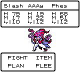

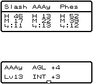

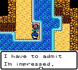

## Fisherman's story and original save

The party travelled to the city pub and heard the fisherman's tales with Squiz
present. The original aquatic-family check accepted HoodSquid and the dialogue
set flag 0x6D. The subsequent original Journal and fresh Continue passed. The
finite 64,544-frame replay independently reproduced Journal SHA256
`c1c08b994e7efcfdf8b0afea76f11aca1da20575f649c7222d2b5ac456165baf`
on the pinned Windows executable under Wine, native exit 0. Spotslime had fainted
during travel; that genuine state is preserved in this checkpoint.

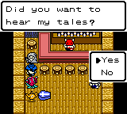

## Mermaid palace reached

Original GreatLog-key travel restored the complete party, including the fainted
member. Tara's farm menus stored Spotslime and retrieved Ellan, whose original
OddDance skill satisfies the dance requirement. The living party returned to
the village, accepted the old man's invitation, and reached the mermaid palace.
The original transport set flag 0x6F.

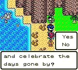

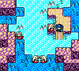

An original palace Journal and fresh Continue passed at frame 93,727, world 65,
region 0,1, position 112,64. Journal SHA256:
`4b8c3fa641af2ed9d76ea6da7963b3c280243dbe2233c8a34a6727c9857f2154`.
The active records are Squiz/Phes/Ellan (9/4/5), levels 12/12/8, HP 89/68/21.
All ten owned monsters remain. Both finite story routes now pass on the pinned
Windows executable under Wine, native exits 0, with exact Journal hashes and
fresh Continue. The validator additionally checks 320 persistent creature bytes,
all ten farm/active statuses, species, quest flags, location and the original
wallet. Report: [story-checkpoints-wine.json](evidence/2026-10-24/story-checkpoints-wine.json).
Native Windows run
[40102961243](https://github.com/rjtvandenhout/DWM2t/actions/runs/40102961243)
at commit `948ff81d54892f50d0fcfa8dbbe0546d2278d4eb` also PASSED, including
all earlier Sea World, farm and training routes. Both archived Journals were
independently downloaded and hashed again; they match the Wine results exactly.
The [Windows report](evidence/2026-10-24/story-checkpoints-windows.json) records
native exits 0 and all ten creatures' persistence checks. Evidence artifact
12563713478 is 134,990 bytes; archive SHA256
`200453385b33f21fcaa6e50497b25b38f4b56fe15244a38260e030c436898b77`.
PR ROM verification run 40102954112 passed both build paths.

## Breeding access and stronger active party

The user requested original breeding to strengthen the team. Squiz is reserved
until his story role is complete. Breeding has not happened yet: the original
shrine access flag 0x22 is clear. Original NPC tables retain the two entrance
NPCs until that flag is set; the original Sea World treasure event sets it
(bank 15:$6822, following the Kameha/treasure/Warubou sequence). This gate is
being followed through normal story progression.

The party returned through the original mermaid transport and GreatLog key.
Tara stored Ellan safely and retrieved Slash. The next original Journal and
fresh Continue passed: active records 9/4/0, levels 12/12/11, full HP 89/69/102,
all ten owned monsters retained. The finite 58,319-frame replay reproduced
Journal SHA256 `c83ab756355ee300158dfd0035afc2ae23e94d457f5ef04343957517385b1aee`
and passed fresh Continue under Wine. The additional validator passed all 320
persistent creature bytes, flags, location and wallet; native exit 0.
[Report](evidence/2026-10-24/strong-party-wine.json).
This third stage subsequently passed Windows CI in run 40109654218 below.

## Ghost ship: first captain attempt and recovery

The party boarded the original ghost ship north of Yold, defeated the pirate
guard on its second floor, and reached the captain's quarters. The captain
encounter contains CaptDead (500 HP) and two 72-HP escorts. The defense setup
was insufficient against this group: the original game reported a party wipe.
This is a defeat, not a captain victory or MoonRock reward.

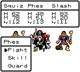

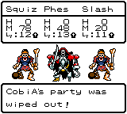

Warubou's original recovery restored Squiz/Phes/Slash to full HP 89/72/102,
levels 12/13/11. An original GreatLog Journal and fresh Continue passed at frame
83,078. Journal SHA256:
`969ff2bfb1519ea79cb5ebba80edf64f4953ace8a1c3f36c51262406e1d6f8a5`.
The first guard's flag 0x72 and captain-introduction flag 0x74 remain set;
captain-victory flag 0x75 and shrine-access flag 0x22 remain clear. The next
attempt is preparing healing support from ordinary Sea World encounters.
Squiz remains reserved from breeding.

The subsequent preparation Journal also retains Nyar, a Merman recruited and
sent to the farm through the original naming and party-choice menus. Its
138,371-frame replay passes under Wine, including the recorded defeat and
recovery, all eleven owned creatures (352 persistent bytes), exact Journal
`2f8ef50a95e66c1a40c7454af774347bbbb5e184fdb5249b9146b2c9ce4a4be7`
and fresh Continue. [Report](evidence/2026-10-24/captain-preparation-wine.json).

## Captain defeated and MoonRock obtained

The retry used Squiz's original LureDance to interrupt enemies, Phes's Increase
to raise defense, and ordinary attacks/spells. The original victory sequence
awarded 742 EXP. Squiz and Phes survived; Slash fainted. Flag 0x75 was set by
the victory. The original chest then awarded the MoonRock, set flag 0x76 and
returned the party to Yold as the ghost ship disappeared.

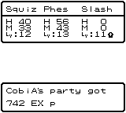

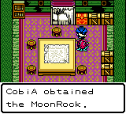

An original Yold Journal and fresh Continue passed at frame 50,283, world 49,
region 0,1, position 64,112. Journal SHA256:
`870a898d5e2264f8b489b7084cb2643d140d9132c4f414aa1b73323c69524197`.
The finite replay independently reproduces that exact Journal under Wine,
native exit 0. All eleven creatures' persistence checks pass, as do flags,
wallet, location and the original MoonRock inventory byte 0x31 before and after
Continue. The preserved party is 9/4/0, levels 13/14/11, HP 40/56/0, with Slash's
original fainted status intact. [Report](evidence/2026-10-24/moonrock-wine.json).
Native Windows run
[40109654218](https://github.com/rjtvandenhout/DWM2t/actions/runs/40109654218)
at commit `7ef2dd46ff84a3617e8973571040ba07e9dbb94d` PASSED the expanded chain:
all previous Sea World/farm/training routes plus all five story checkpoints.
The five archived Journals were independently downloaded and hashed again;
each exactly matches Wine. The
[Windows report](evidence/2026-10-24/sea-moonrock-chain-windows.json) includes
the fainted-monster, eleven-creature and MoonRock inventory checks. Artifact
12566930835 is 330,199 bytes; archive SHA256
`84666ff8b6c24fc2486a084726195a9609a6e8c956fd7a16da2dadd73ccc7c0b`.
PR ROM verification run 40109630164 also passed.

## Lighthouse route in progress

The party returned through GreatLog to revive Slash, found two original Herbs,
climbed the lighthouse and recruited a RayGigas sent to the farm. One Herb was
used through the original item and target menus. At the pinnacle, using the
MoonRock at the pedestal consumed that quest item, set flag 0x7A and changed
the original Sea World map mask to 0x02. The volcano entrance is now reachable.

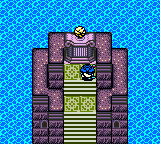

The party followed Kameha through the first three volcano events (flags
0x7B, 0x7C and 0x7D). A test-guide routing error treated lava as ordinary floor;
the original lava damage caused a genuine party wipe. The guide now assigns
lava a high movement cost and prefers stone paths. This was a guide correction,
not a change to the native game. Warubou's original recovery restored the party
and retained the quest progress, all twelve owned monsters and the found Rib.

The next original Journal and fresh Continue passed at frame 110,161 in GreatLog:
records 0/4/9, levels 12/15/13, HP 107/74/92, no fainted members. Journal SHA256
`61fc465f2270d966abf761d96a062517b676a7e6ccacbd5fab221592fb774d90`.
The 110,161-frame transcript is pinned without changing any P1 input. Independent
finite replay passed under Wine with the exact Journal hash, all twelve owned
creatures and fresh Continue. [Report](evidence/2026-10-24/lighthouse-recovery-wine.json).
This stage has not yet passed Windows CI.
Sea World, breeding, the remaining worlds and ending/credits remain in progress.

## Sea World treasure event and shrine unlock

The corrected stone route reached the original LootVault. The complete Kameha,
treasure and Warubou event returned the party to GreatLog, set flags 0x7E/0x7F
and unlocked Starry Shrine with flag 0x22. All three active monsters survived.
The original Journal at frame 28,012 and its fresh Continue passed. Exact Journal
SHA256: `046ef944cc794c4f8272cb306f82f7cefa44b3dd53908de7bc6267ec7a779074`.
The independent finite replay also passed under Wine, retaining all twelve
owned monsters, full HP 74/92/107, quest bytes and two found Ribs.
[Report](evidence/2026-10-24/sea-treasure-wine.json).

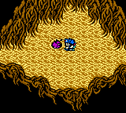

## Original breeding: Octokid +1 egg

After the Sea World story role was complete, the original shrine preview
confirmed **Squiz (HoodSquid, male, level 13) × Phes (CurseLamp, female, level 15)
→ Octokid +1**. The user explicitly allowed Squiz after that story part. The
original ceremony consumed both parents and produced an Octokid egg; no roster,
gene, stat, skill or money writes were used. The other monsters remain in the
original roster, which the game compacts after breeding.

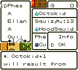

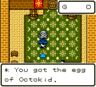

The two original Ribs sold for 320 G at Yold. Buying 24 Herbs and paying the
20 G hatching fee left 60 G. The original ceremony hatched a female Octokid +1,
named **Liset** by the game. Ellan was stored safely and Liset joined Slash and
Totum (RayGigas). Her level-1 stats are HP 41, MP 37, attack 30, defense 42,
agility 44 and intelligence 71; no skills are learned yet at birth.

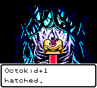

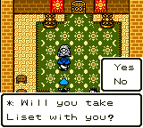

The original farm Journal at frame 69,744 and fresh Continue passed. Independent
finite replay reproduced exact Journal SHA256
`e1151817365e74414719f21e274f137150bbe5e3d54c3c8f63b823dadc184ce7`.
The validator checks all eleven owned creatures, the complete mapping of the ten
retained monsters after the game's roster compaction, plus-one generation,
gender, learned skills and inherited data. It compares 1,287 persistent creature
bytes after Continue, including the extra inherited-data ranges; original
name-padding normalization is left to game code. [Report](evidence/2026-10-24/octokid-birth-wine.json).

Ordinary battles and GreatLog-key healing are now training Liset. At level 6 the
original skill list contains Heal (0x16), Increase (0x26) and SpeedUp (0x2A).
The team now has healing and the two inherited support skills. Training continues
before the next Arena/story gate; no later-world or ending claim is made.

## Level-10 healer and inherited support verified

Liset reached level 10 in ordinary battles. The original game upgraded Heal to
**HealMore** and retained **Increase, SpeedUp and MPass**. Her full level-10
stats are HP 58, MP 73, attack 47, defense 78, agility 81 and intelligence 143.
Slash/Totum/Liset now have levels 13/12/10 and full HP 115/80/58. The wallet
contains 360 G; all eleven owned monsters and the 24 purchased Herbs remain.

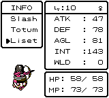

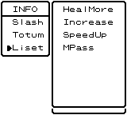

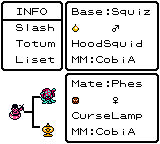

The original GreatLog Journal at frame 130,852 and fresh Continue passed. An
independent finite replay reproduced exact Journal SHA256
`1e1f07c5042f69743a9ecfc3974aabfcc39a88b5863e755bd2897bc72fe9edee`.
All eleven creatures, 1,287 persistent creature bytes, learned skills, quest
flags, original inventory and wallet passed additional assertions.
[Report](evidence/2026-10-24/octokid-training-wine.json).
The team subsequently won C Class as recorded below.
These breeding/training stages subsequently passed Windows CI in run 40115888033 below.

## C Class tournament: defeat, healing tactics and victory

The first original C Class attempt won two rounds but lost the final round.
Liset's initial Charge tactic left healing spells unused. Original Arena
recovery restored the party; no checkpoint rollback or state edits were used.

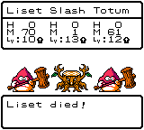

On the retry, the original Plan menu assigned Liset Defense, Slash Charge and
Totum Mixed. Liset's healing helped keep every member alive through the final
winning round. The original aftermath advanced Arena class 1→2 and awarded an
additional Magic Key. This is not a claim that the prize is IceKey.

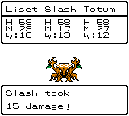

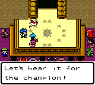

The GreatLog Journal and fresh Continue passed at frame 40,179. Independent
finite replay reproduces exact Journal SHA256
`613ab882b284768c3a973ed2fd553c8b7623147e9cc050340d9a180e380f0def`.
The additional checks pass all eleven creatures, 1,287 persistent creature
bytes, learned healing/support skills, full HP 58/115/80, 160 G, the original
24 Herb slots, quest bytes and Arena class 2 after Continue.
[Report](evidence/2026-10-24/c-class-victory-wine.json).

Windows run 40113953600 was cancelled after its runner stalled during setup.
Replacement run [40115888033](https://github.com/rjtvandenhout/DWM2t/actions/runs/40115888033)
at `42bbd5a5920d071ffb1517db731382fcf9cf2e03` **PASSED** all previous
Sea World/farm/training routes and all nine story checkpoints through original
breeding and level-10 training. Every archived Journal was downloaded and hashed
again independently; all nine exactly match Wine. Artifact 12570447866 is
594,055 bytes; archive SHA256
`79727e2b210bc0d5d9105f81dddd78862312d19bec3a0f071f3d26b4d61e421e`.
[Windows report](evidence/2026-10-24/sea-breeding-chain-windows.json).
The later C Class route is not part of that run. PR ROM checks 40113956484 and
40115553023 also passed.

The ArmyAnt trade at the original GreatLog harbor awarded a TinyMedal and opened
the trader's shop. The initial link to IceKey was misread; that completed side
quest is retained. Another original key event is being investigated before the
next story route. No Ice World entry or completion is claimed.

## Linked monster trades and original IceKey reward

An ArmyAnt was retrieved from the farm and given to the harbor trader through
the original request. The original game compacted the roster and awarded a
TinyMedal. One of the 24 Herbs was tossed through the original item menu to make
room for that reward. The other ArmyAnt and all unrelated monsters remain.

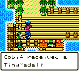

Ordinary Sea World encounters recruited **Torma (Healer)**, **Almmo (Pixy)** and
**Arma (MadGopher)** through original naming and farm menus. The MadGopher-ready
Journal at frame 60,818 passed fresh Continue and independent finite replay.
Exact SHA256: `b7c01f29ab715f15e75a5357a7884f2fa9759558c4da8aa50479e009781bb525`.
The additional checks cover all thirteen creatures, the ArmyAnt trade's complete
roster-compaction mapping, 1,521 persistent creature bytes, learned skills,
original quest bytes and the wallet. [Report](evidence/2026-10-24/madgopher-ready-wine.json).

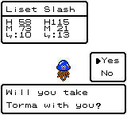

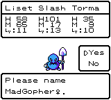

Arma was then retrieved to help Dad dig at the farm. After the original digging
event, Dad awarded **IceKey**. The earlier ArmyAnt trade and this MadGopher task
are linked: the second completed event supplies the key. The initial assumption
that ArmyAnt alone awarded it was corrected by these original game events.
Both quest monsters were given through their original requests; all other
monsters, including Liset and Torma, remain owned.

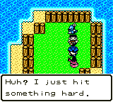

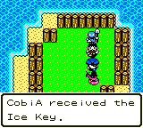

The original farm Journal at frame 13,977 and fresh Continue passed with the
genuine two-member party after the trade (Liset/Slash, levels 11/13, HP 61/115).
Independent finite replay reproduced exact Journal SHA256
`1b41e7df21a346ddb2cf21f2906e345d30c5b5f1ca8269581be31835f6afc108`.
The additional checks pass all twelve creatures, 1,404 persistent creature bytes,
all five original key entries (including IceKey 0x04), Arena class 2, trade flags
0x133/0x134/0x135/0x190/0x191, 160 G and the inventory. Native Continue compares
44 active-creature bytes for this two-member party. [Report](evidence/2026-10-24/ice-key-wine.json).
Totum was subsequently retrieved for Ice World as recorded below.
These later trade/key checkpoints have not yet passed Windows CI.

## Ice World entered; Norden Journal verified

Tara safely retrieved Totum while Torma remained at the farm. The original
Magic Door accepted IceKey and transported the team to Ice World. The party
reached Norden and made an original town Journal at frame 24,821; fresh Continue
passed. Independent finite replay reproduced exact Journal SHA256
`e28221938470fd287f3ec4952e7b3336282feeb344169c7fdc0a20a241caebe3`.
The party is Liset/Slash/Totum (records 9/0/8), levels 11/13/12, full HP 61/115/80.
All twelve owned monsters persist, including Torma and Almmo at the farm.
Additional checks pass 1,404 creature bytes, learned support skills, Arena class,
trade flags, wallet, inventory and all five keys; using IceKey changes its
original entry 0x04→0x44. [Report](evidence/2026-10-24/ice-world-entry-wine.json).

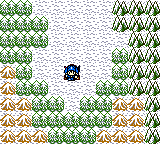

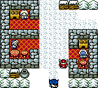

Ice World completion, the remaining worlds, ending/credits and final release
acceptance remain outstanding. The expanded thirteen-stage Windows chain,
[run 40121439217](https://github.com/rjtvandenhout/DWM2t/actions/runs/40121439217)
at commit `95a3919822841f6fc4cf70eb0730d29f1cfad851` **PASSED** all previous
routes and all thirteen story stages, including original two-member Continue,
Arena rank, linked trades, IceKey and Norden entry. Every archived Journal was
independently downloaded and hashed again; all thirteen exactly match Wine.
Artifact 12571886913 is 855,652 bytes; archive SHA256
`6eaf61fae3caafbf54c7493a7d8f662c11c2c10257a7fd1d9344caff37bc4849`.
[Windows report](evidence/2026-10-24/ice-entry-chain-windows.json).

## Ice exploration, original defeat and recovery

Norden's castle guards restrict entry to western representatives. Nofor's
ships are frozen in port; the team subsequently explored the border and gold
mines. Repeated unsuccessful escapes left Liset and Totum fainted. After
original Herbs restored Slash, a later ordinary overworld encounter defeated
the remaining party. Warubou returned the team to GreatLog and restored every
member. Gold fell from 160 to 80; all twelve owned monsters remained.
This exploration is not an Ice World completion checkpoint.

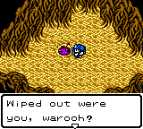

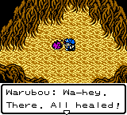

The recovered team then won an original Ice encounter with all three members
alive; Totum gained level 13. Further original battles near the Magic Door are
training the team, with GreatLog-key travel providing original healing between
fights. The finite route retains the defeat, recovery and training inputs.

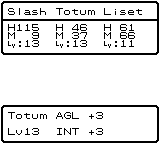

The completed training Journal at frame 295,304 has Slash level 16, Totum
level 17 and Liset level 17, with full HP 138/113/73. All twelve previous
monsters remain; an original WingSlime recruitment adds a thirteenth at the
farm. Totum now knows Firebane. Liset now knows **HealAll and TwinHits**, in
addition to Increase, SpeedUp and MPass.

The new finite route independently replays under Wine to the exact original
Journal SHA256 `d8e8e6992d67bf03df63edd302b36d02778084b680bdb7ad9831b60fae97bbd1`.
Fresh Continue checks every owned creature, the five key entries, Arena rank,
all 56 quest bytes and 1,521 additional persistent creature bytes. Native
Windows acceptance of this fourteenth stage is still pending.
[Training report](evidence/2026-10-24/ice-training-wine.json).

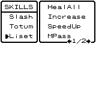

## Spirit's Crest and Norden inn Journal

The original northern spring spirit asked Cobi to restore peace and appointed
him as envoy. Its treasure chest awarded the **Crest**, item 0x32, setting
quest flag 0x80. The spirit promises the Sky Shield after peace is restored;
that reward has not yet been earned.

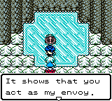

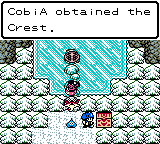

Norden's inn charged the original 10G and restored the party. The Journal at
frame 61,681 has Slash/Totum/Liset at levels 16/18/17, full HP 138/116/73,
all thirteen owned monsters and 70G. The finite route independently replays
under Wine to exact Journal SHA256
`c20f93ffdc1a7a282cc5903d36ae56bd0838df89daaece1088e169e0e143bec1`.
Fresh Continue retains the Crest, all five keys, Arena rank, skills and owned
creature data. [Crest report](evidence/2026-10-24/ice-crest-wine.json).

This route also exposed an overly strict validator assumption: original
Continue clears unused bytes after the F0 nickname terminator in the newly
recruited WingSlime's name. Retained-name checks now compare the original
visible nickname and species; fresh Continue checks every owned nickname.
The complete raw 32,768-byte Journal hash is still required. No runtime or
game data was changed. Native Windows acceptance of stages fourteen and
fifteen is pending.

## BombCrag defeated and Norden jail escaped

The original B-button jump crossed the gap in the gold mine's central shaft.
Examining the rock started the original **650 HP BombCrag** fight. Liset's
TwinHits doubled Totum's attack; the original battle message confirms it.
BombCrag's boulders fainted Slash. Totum and Liset finished the fight with
original Herbs, HealAll and battle tactics; no HP or other game state was set
by the host.

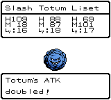

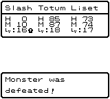

The original explosion revealed only gold dust, and both rival miners left
to report to their kings. Norden's king rejected that report, accused Cobi of
being a spy and imprisoned him. In jail, Cobi met Kameha and the real king,
who revealed that an impostor had taken his throne. Examining a hollow wall
let Kameha open the sealed exit. The escape returned Cobi behind the throne,
where the two kings confronted each other. The impostor remains unresolved.

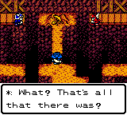

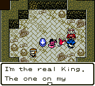

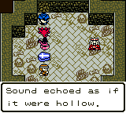

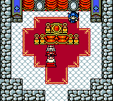

The original town Journal at frame 75,754 independently replays under Wine
to SHA256 `494ed3a48672d938c986a8ce96fc21c5e3359e6387f75195087190592bc7ee48`.
Party order is Totum/Liset/Slash, levels 18/18/16, HP 63/70/0 and status
0/0/0x80. All thirteen owned monsters remain, gold is 460G, and the ExitBell
found earlier was consumed through the original item menu to escape the mine.
Fresh Continue retains the fainted member, the owned roster and inherited
data, Crest, Arena rank, all keys and all 56 quest bytes, including flags
0x85–0x8B for the mine and jail sequence. Native Windows acceptance of this
sixteenth stage is pending.
[BombCrag and jail replay report](evidence/2026-10-24/bombcrag-escape-wine.json).

## AgDevil defeated; Norden restored and border reopened

Norden's original priest revived Slash for 85G. The inn then restored the
party for 10G. Repeated questioning exposed the false king as **AgDevil**,
starting its original **550 HP** battle. Liset cast TwinHits on both Totum
and Slash. AgDevil's SleepAir put Liset and Slash to sleep; original Herbs
supported Liset until she woke and resumed HealAll. All three monsters
survived the victory.

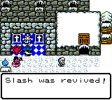

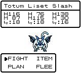

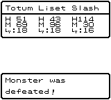

The real king promised to end the dispute and reopen the western border,
setting flag 0x94. A second original 10G inn rest and town Journal at frame
37,976 retain all thirteen monsters, active Totum/Liset/Slash at levels
19/18/16, full HP 118/76/138, no status conditions and 355G.

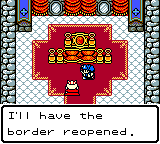

The finite route independently replays under Wine to exact Journal SHA256
`16a86744a4e6416083a49b371d5b9071faae0036318306ac6364f2b79938cdd0`.
Fresh Continue passes the owned roster, names, skills, inherited data, keys,
Arena rank, wallet, inventory and all quest bytes. Both new boss fixtures
also assert the observed original combat mode and full enemy HP at the
first battle menu: 650 for BombCrag and 550 for AgDevil. Adding those read-only
witnesses preserves the exact controller stream and Journal hashes; both
replays pass. [Norden report](evidence/2026-10-24/norden-restored-wine.json).

Native Windows acceptance of stages fourteen through seventeen is being
batched on the pinned executable. Ice World completion, subsequent worlds,
ending/credits and final production acceptance remain outstanding.

## Westania's original performance and later Journal

The reopened border led through Weston to Westania. Reading the palace
notice started Kameha's arrival and the invitation to restore Lady Yuna's
laughter. After admission, the original performance played before the king
and Yuna. The king praised Cobi's act, but Yuna remained unresponsive; the
court described her as a soulless puppet. Her private room is still guarded.

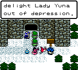

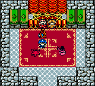

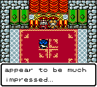

The original town Journal at frame 63,864 independently replays under Wine
to SHA256 `7324097161189f30ada19a2577750b36b98bafe14a7e67bebf5d87566bff0f8c`.
It retains all thirteen monsters, Totum/Liset/Slash at levels 19/19/17,
HP 86/58/109 with no status conditions, 945G, Crest, TinyMedal and ten Herbs.
Fresh Continue verifies the Westania notice/performance flags 0x95/0x96,
all prior quest bytes, owned names, skills, inherited data, keys and Arena rank.
[Westania report](evidence/2026-10-24/westania-performance-wine.json).

Seventeen-stage native Windows run
[40130993635](https://github.com/rjtvandenhout/DWM2t/actions/runs/40130993635)
started successfully at `f37cbcc4992605a747977376975dec499135ce98` and reached
the story-chain step. The cloud environment's temporary GitHub credential
subsequently began returning HTTP 401. Its final outcome and artifacts have
not been retrieved; the latest independently audited Windows chain remains
the thirteen-stage run above. Local gameplay and validation continue. This
eighteenth stage is also awaiting native Windows acceptance.

## Next work

Continue the original Arena and remaining worlds, ending/credits, combined regressions and final
packaged-player checks. Update this record as those steps are actually verified.

The screenshots are lossless encodings of the original 160×144 framebuffer.
[Provenance](evidence/2026-10-24/screenshots/provenance.json) records each source
frame, native state witness and BMP/PNG hashes. Screenshots illustrate progress;
the controller transcripts, exact Journals and native validation logs provide
the reproducibility evidence.

Actions storage cleanup is complete: 159 obsolete generated artifacts removed,
3,946,430,584 bytes reclaimed; all protected artifacts were independently checked
afterward. See [the audit](ACTIONS_STORAGE_2026-10-24.md).
