# M8 progress and screenshots — 2026-10-25

Current playthrough: Sky World is complete, Mudou is defeated and the Limbo
Key is obtained. The first Limbo guardian attempt ended in defeat; the party
is training through original encounters before retrying.
Local Wine validation covers 33 checkpoints; native Windows covers 30.

M8 remains in progress. All 256 ROM banks are statically compiled, M1–M7 remain
validated, and the original native core and restore fixtures are unchanged.
The earlier [progress record](M8_PROGRESS_2026-10-24.md) contains the Sea and Ice
story, both original breeding sequences, Windows evidence and storage cleanup.

Native Windows acceptance covers 30 cumulative story checkpoints: twenty
archived checkpoints audited and ten later routes replayed in run 40152139075.
The unchanged production player also passed late Continue, original Journal
Save, normal shutdown and fresh-process reload on native Windows. The latest
run, [40148371157](https://github.com/rjtvandenhout/DWM2t/actions/runs/40148371157),
repeats that check with the full 107-byte quest comparison and passes. These checks do not certify the ending or final M8 release.

## Pei, recovery and a thirteenth monster

The original ChangeStaff disguise let Cobi pass the guarded bridge and reach
Pei. A villager described the MadCondor's attraction to shiny things. During
travel, Gigantes joined through the original recruitment/naming flow and was
placed on the farm. Liset fainted on the mountain approach. Derzo's inherited
Vivify revived her on its second attempt; original HealAll restored the party.
The party subsequently rested at Pei's traveler inn for 10G.

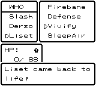

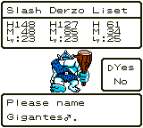

The 26th original Journal independently replays under Wine in 156,892 frames.
SHA256: `fc4be98a84c03cd273c4ab422f9d85af911b9d828afe07e8c6f77e469fd9e736`.
Slash/Derzo/Liset are level 23/24/26, full HP 151/175/90, status 0/0/0, with
thirteen owned monsters and 186G. The complete roster, inherited data, learned
skills, keys, inventory and quest bytes persist after fresh Continue.
[Replay report](evidence/2026-10-24/pei-inn-wine.json).

## The complete original quest block

Sky's bridge uses flag 0x209 beyond the previous 64-byte comparison. Original
bank 2:$7636 and $76AC save and restore CBD7 with length 0x6B, giving 107
bytes at original Journal offset 0x3DA0. The story and production GUI validators
now compare this complete original block. The pinned executable, native M7
constants and accepted M1–M7 fixtures remain unchanged.

All 24 archived Windows story captures and the two later Wine captures pass
an independent comparison of source RAM, the original Journal and fresh
Continue for all 107 bytes. The native Windows production Save also preserves
all 107 bytes in an additional read-only check. A subsequent actual Windows
GUI run 40148371157 also passes the 107-byte version directly, including both
normal shutdowns and all twelve original monsters. Saved Journal SHA256:
`186d7f319aa77450419e7b68e99c4856cd12be079185ed6b96d53380b211e131`.
Artifact 12581700440 is 19,527 bytes; archive SHA256
`ea8079ccf57471b0f467b42557009377a9f229fcc2d8a3371ce0df2a432a1cc7`.
[Windows GUI report](evidence/2026-10-24/production-late-107-windows.json).
[Full quest-block audit](evidence/2026-10-24/full-quest-block-audit.json).

## Cloud flight, disguise and the MadCondor

ChangeStaff copies a character from the current room. Repeated use in rooms
without a usable character correctly produced no transformation. Pei's
Swordgon provides a shiny disguise, but its duration expired just before the
nest during the first ground route. Normal jump input did not cross the tested
mountain tile. No runtime fix or game-state write was made for these guide errors.

The unlocked original cloud flight crosses gaps until it reaches land and
preserves the disguise during flight. The party used it across Sky World's
islands and reached the nest with 53 disguise steps remaining.

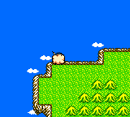

The original encounter contains a 600-HP MadCondor. Slash had fainted during
travel; Derzo revived him on its second Vivify attempt. Increase and TwinHits
supported the physical attacks. The party defeated MadCondor with all three
alive, and MadCondor joined the farm through the original naming flow.

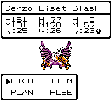

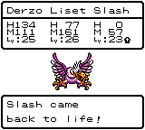

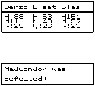

The nest's WorldDew chest was collected. The LightOrb chest was empty, so the
LightOrb search remains unresolved. The original Plan menu refused Journal
Save at the nest. Its complete controller input, including that refusal,
replayed exactly from the Pei Journal. The party returned to the traveler inn,
rested for 10G and made a successful original Journal there.

The 27th route independently passes 136,123-frame Wine replay and fresh
Continue to Journal SHA256
`2655aa444fb56f2312e36b48ec446d0e085024ff3e11001fcc282fd3e6814788`.
Derzo/Liset/Slash are level 25/27/24, full HP 176/90/154, status 0/0/0, with
fourteen owned monsters and 166G. The 600-HP combat witness, original cloud
flight, farm recruitment, learned skills, inherited data, keys, inventory and
all 107 quest bytes pass the pinned replay checks.
[MadCondor replay report](evidence/2026-10-24/madcondor-nest-wine.json).

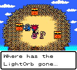

Screenshots are lossless encodings of the original framebuffer. Their source
frames and hashes are in [provenance](evidence/2026-10-24/screenshots/provenance.json).
Sky's remaining story, ending/credits, combined regressions and final production
release acceptance remain outstanding. Work continues through the whole game.

## Next Heaven items

The next settlement's royal notice promises LightOrb in exchange for Heaven
Sword, Heaven Armor and Heaven Helmet. The first tower entrance is a small
hole that refuses Cobi's normal shape. Original ChangeStaff use in the nearby
town produced a smaller monster disguise; this route continues through the
original entrance and dungeon.

Windows run [40148369185](https://github.com/rjtvandenhout/DWM2t/actions/runs/40148369185)
at `e436f1fa4c137bdf914512365ae5fd448963672c` passed checkpoints 21–27
after auditing the twenty archived Windows checkpoints with current assertions.
All seven downloaded original Journals match Wine and independently pass the
current 107-byte quest and complete-roster assertions. Artifact 12582107420 is
468,999 bytes; ZIP SHA256
`807cf60ac51d2c1f571ec0e3b2040ccc8fff0a2092f61a6b373b1f81f2ad8f09`.
[Windows suffix report](evidence/2026-10-24/madcondor-suffix-windows.json) and
[prefix audit](evidence/2026-10-24/madcondor-prefix-audit-windows.json).

## Third breeding: Garon, RayGigas +3

The original royal notice requests three Heaven items for LightOrb. The small
tower hole refuses Cobi's normal head. On the return journey the party was
defeated; Warubou recovered them and gold fell from 166G to 83G. That loss and
the subsequent recovery remain in the complete controller route.

Liset (female Octokid +1, level 27) and Varli (male MadCondor, level 30) bred
through the original shrine. Liset as the base yields RayGigas +3. The original
40G hatch produced Garon, a male with WLD0, HP59, MP74, ATK65, DEF70, AGI85 and
INT131 at level 1. Both parents were consumed by the original game; the other
twelve monsters retain their names/species through roster compaction.

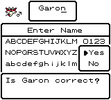

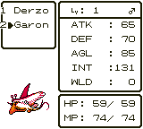

Checkpoint 28 independently passes an 85,603-frame Wine replay and fresh
Continue to original Journal SHA256
`111a2214b78f69882ce8e0a0ddfe9d4391f2fb42511ec03b39b9686e7d3cd720`.
Derzo/Garon/Slash are level 26/1/25, full HP 178/59/155, status 0/0/0,
with thirteen owned monsters and 43G. The +3 generation, gender, inherited
bytes, complete roster and all 107 quest bytes pass the assertions.
Garon had no learned skills at birth; original battles are training him for
healing duties before the remaining dungeons.
[Breeding replay report](evidence/2026-10-24/garon-birth-wine.json).

Original Sky battles then trained Garon to level 17, HP174, MP114, with
HealAll, MPass, Increase, SpeedUp, Firebane, LureDance, TwinHits and CallHelp
in the original learned list. The original Magic Door healed the party between
battles. Checkpoint 29 passes 86,481-frame Wine replay and fresh Continue to
Journal SHA256 `5d309edcf0c35048b7883efdee62216243a81555893d0e5031ffe5d78c5d5cc8`.
Derzo/Garon/Slash are level 27/17/25, full HP178/174/155, with thirteen owned
monsters and 43G. The first replay invocation failed before executing the game
because its derived manifest used a relative route path; the corrected absolute
path replays unchanged controller input successfully.
[Training replay report](evidence/2026-10-24/garon-training-wine.json).

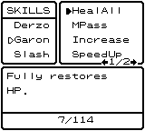

A smaller ChangeStaff disguise subsequently passed the original small-hole
entrance into the Heaven Sword dungeon. The Heaven items are not yet obtained.

## Heaven Sword

The smaller ChangeStaff disguise passed the original hole into the dungeon.
During exploration, Garon reached the eight-skill limit. The original skill
menu replaced LureDance with MouthShut while retaining HealAll, Increase and
TwinHits. MPass upgraded normally. Additional monsters joined the farm through
the original naming flow.

The guardian is Metabble, with 20 HP and 999 defense. Defense had no effect;
physical attacks and original Herb use won with all three alive. Earlier
menu guidance selected CallHelp and SpeedUp; those ordinary inputs remain in
the replay. The guardian cleared and the original chest awarded Heaven Sword.

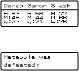

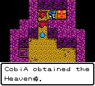

The party returned through the dungeon, used original HealAll, rested at the
next settlement's traveler inn for 10G and saved through the original Journal.
Checkpoint 30 independently passes a 131,651-frame Wine replay and fresh
Continue to Journal SHA256
`94d024c3d3aa146f246136b0c7107d69b4a05bf67f784aaafbbe68344bccd06d`.
Derzo/Garon/Slash are level 29/24/27, full HP184/188/157, status 0/0/0,
with sixteen owned monsters and 33G. All 107 original quest bytes, learned
skills, inherited bytes, farm identities, keys and inventory persist. The
finite route also asserts the original 20-HP/999-defense battle witness.
[Heaven Sword replay report](evidence/2026-10-24/heaven-sword-wine.json).

Heaven Armor and Helmet, LightOrb, the later story, ending/credits and final
release acceptance remain outstanding.

## Heaven Armor

The platform maze required the original unlocked flight to cross gaps between
rooms and floors. Walking and the tested B input did not cross the first gap;
A facing the gap invoked the original flight. The party traversed the maze,
opened the Heaven Armor chest and returned normally. Original HealAll restored
Derzo during the return; the traveler inn then rested the whole party for 10G.

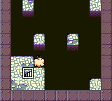

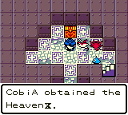

Checkpoint 31 passes 97,722-frame independent Wine replay and fresh Continue
to Journal SHA256
`97d1fe94ec209aa00f55fa0169d852061b65bd3c30c3df731bbc9e8b2c31f46b`.
Derzo/Garon/Slash are level 30/25/28, full HP187/189/160, status 0/0/0,
with sixteen owned monsters and 23G. Both Heaven Sword (57) and Armor (58),
all 107 quest bytes and the complete owned roster persist after Continue.
[Heaven Armor replay report](evidence/2026-10-24/heaven-armor-wine.json).

The live continuation has entered the Helmet tower. Windows run
[40152139075](https://github.com/rjtvandenhout/DWM2t/actions/runs/40152139075)
passed checkpoints 21–30 after the audited twenty-checkpoint prefix.
All ten downloaded Journals match Wine and independently pass current
107-byte quest and full-roster assertions. Artifact12584475629 is 673,140 bytes;
ZIP SHA256 `a863a8f68d01724c0f928b2bd294a302224b86ee5d0053af3e3f7c67a4e48fe7`.
[Windows suffix report](evidence/2026-10-24/heaven-sword-suffix-windows.json) and
[prefix audit](evidence/2026-10-24/heaven-sword-prefix-audit-windows.json).
The ending and final production acceptance remain unverified.

## Heaven Helmet

The original coffin switches rotate coupled states. Reading the original
puzzle rules helped plan the walking sequence; all changes were made by P1.
The gate opened after all four coffins reached their resting state. A second
trial guided the lost soul through the original arrow buttons. The final
cemetery clue led to a gravestone button that opened the upper door.

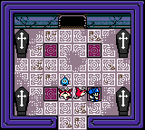

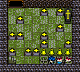

Niterich has 1,500 HP. IceStorm damaged the whole party. Garon's learned
MouthShut sealed the breath attack; Increase, HealAll and TwinHits supported
the physical attacks. Niterich was defeated with all three monsters alive,
and the chest awarded Heaven Helmet. The party returned through the tower,
rested at the traveler inn for10G and saved through the original Journal.
Checkpoint32 independently passes a157,612-frame Wine replay and fresh
Continue to Journal SHA256
`a825958b8e9c8aee2cd3c176187f853d7390c3ba728e7cdbe746723ec4b06b1e`.
Derzo/Garon/Slash are level32/29/31, fullHP191/197/168, status0/0/0, with
sixteen owned monsters,13G and HeavenSword57/Armor58/Helmet59. All107 saved
quest bytes, puzzle states, skills, inherited data, keys and inventory persist.
The finite route asserts the original1500-HP Niterich battle.
[Helmet replay report](evidence/2026-10-24/heaven-helmet-wine.json).
Native Windows acceptance of this later route remains outstanding.

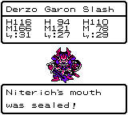

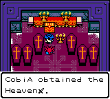

The live continuation was admitted to the palace with all three relics. The
chancellor directed the party to the king's meeting chamber and unlocked the
traveler gate at the rear. The party has used that original gate and continues
toward the king's castle. LightOrb and the remaining campaign are not yet complete.

## Sky completion and Limbo

The castle's two EvilArmor guards each had 450 HP. Increase, Defense, TwinHits
and HealAll won with all three monsters alive. An original Antidote cured
Derzo's poison after the battle. The meeting chamber accepted Heaven Sword,
Armor and Helmet, then its gatekeeper Mudou attacked with 3,000 HP. Mudou
resisted MouthShut and Defense and used DeMagic to dispel buffs. Physical
attacks, Garon's HealAll and Slash guarding won with the whole party alive.

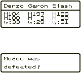

Kameha was revealed as the Monster King. Darck appeared, took the LightOrb
and treasures, and the original story awarded Limbo Key. Warubou returned the
party to GreatLog and restored them. A second conversation supplied the
repaired TidalBell, HarMirror and SkyShield for the next world.

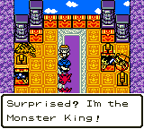

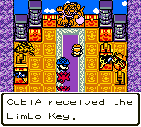

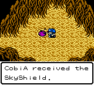

Checkpoint 33 passes a 114,894-frame independent Wine replay and fresh
Continue to original Journal SHA256
`11deaaa8784a7f79c24132173a2fb2cbd221281f2314c9da97f058f9fca51a0b`.
Derzo/Garon/Slash are level 33/30/32, full HP193/200/170, status0/0/0,
with sixteen owned monsters and13G. Both boss battle witnesses, the complete
107-byte quest block, roster, skills, inherited data, keys and inventory pass.
[Sky completion replay report](evidence/2026-10-24/sky-complete-wine.json).

The live continuation uses Limbo Key and gives the three repaired treasures
to the original guardian. Centasaur/GigaDraco/Garudian have900/1000/800HP.
StopSpell sealed the healers' spells, and the first attempt ended in defeat.
Warubou restored the party normally. The complete attempt and recovery are
retained in the finite controller trace. Training now uses original encounters
beside Limbo's return gate, with original healing at home between fights.
No runtime or game-state patches have been made.

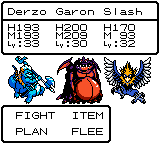

## Preparing exact-source validation

The new manual `recomp-full-validation.yml` workflow builds fresh diagnostic
and production executables independently from the same exact source commit
in new source/build directories. Historical binary pins remain the default;
an explicit, hashed build identity lets current validators check a fresh
binary without relabelling old evidence. The workflow retains M1–M7 tests,
replays the whole recorded campaign and checks the copied production package.
This workflow has not yet produced final M8 acceptance.

Local preflight passes10 build/package provenance contracts and41 existing
safe-resume contracts. The modified story driver independently reproduces
the original Ice Key Journal under Wine in13,977 frames, using the unchanged
historical binary and pins. A copied historical production EXE also passes
direct no-argument startup under Wine, including its window, exclusive save
lock, normal exit and unchanged executable.
[Story-driver integration](evidence/2026-10-24/identity-default-integration-wine.json).
[Direct production startup](evidence/2026-10-24/production-noarg-wine.json).

Linux filesystem checks pass21 original contracts and15 new fault contracts.
The latter stop a real child during a partial temporary write, inject write/
flush failures, retain the previous32KiB file and dirty flag, verify fresh load
ignores the abandoned temporary, and exercise an exact temporary-name collision.
These compile the original persistence code in a separate test executable;
no production persistence code changes. Windows checks remain pending.
[Compiler, source hashes and results](evidence/2026-10-24/save-io-local-preflight.json).

Ending/credits, later Windows story replay and final production-package
acceptance remain outstanding. Work continues through the whole game.
