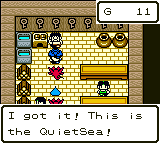
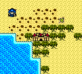
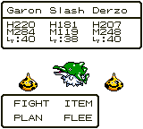
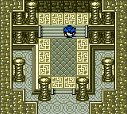
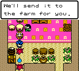
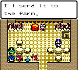
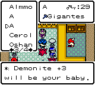
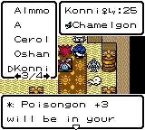
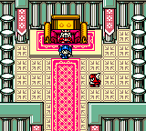

# Postgame and random Magic Key checks

The accepted M8 player and `restore/recomp-m8` remain unchanged. These checks
use the accepted complete-AOT diagnostic from source `3d573873ae81`, executable
SHA256 `f93b7f96212559f65f05e09f8443a224bbda7d124047047fbf53510e16ae0321`.
The initial input is a copy of the genuine ending Journal `0649c4ef…`. Every
game action is original P1. Observational RAM/SRAM captures are never input
seeds. Host tools do not edit game memory, RNG, party, flags or generated worlds;
the original game owns every progress change through P1.

## Actual play and persistence

Seven original Journal checkpoints are pinned in
[`m8_postgame_supplemental.json`](../tests/m8_postgame_supplemental.json),
totalling 270,152 recorded P1 frames. All seven pass on native Windows in
[run 40206283890](https://github.com/rjtvandenhout/DWM2t/actions/runs/40206283890),
including all seven actual-output/input links, exact original Save hashes and
fresh Continue. The native validation job finishes in 2m07s with four isolated replays. Every parallel input is
a pinned genuine original Journal; the verifier compares it with the actual
newly replayed parent output. Independent Wine checks also pass. The native run
uses tooling source `e1a14de3e341` and the unchanged accepted game executable;
it does not rebuild or replace the player. Its complete evidence artifact is
505,039 bytes ([receipt](evidence/2026-10-25-postgame/native-windows-7-stage-artifact.json)).

| Check | Observed result |
| --- | --- |
| Unappraised key | Original Use refuses it; Key Shop charges the correct 90G. |
| QuietSea first use | Original level-8 key, stored seed `16C0`, terrain class 8, recipe 13, 4×4 surface. |
| Generated interiors | Castle, shop, three dungeon floors, stairs and final reward load through original movement. |
| QuietSea world boss | Pumpoise and two allies defeated; party survives at 219/179/207 HP. Original world completion, all four area flags and key clear marker are set. |
| Cache and fresh re-entry | Same key loads the exact saved 404-byte descriptor; seed and cleared state persist. The cleared boss is absent on an actual revisit. |
| Dungeon treasures | Original TinyMedal and SteelFang obtained; chest states persist. |
| In-world Journal | Original PLAN Save inside the castle; fresh Continue restores random context `[0,0,131,0]` and original field mode `1:5`. |
| Newlywed gift | Original WhipBird egg, 18 owned; shared claim flag `CD` set. |
| Evaluator gift | Original introduction and certified Lionex egg, 19 owned; flags `28/29` set. |
| Initial NPC breeding | Unused Gigantes + NPC FunkyBird produces Demonite +3; Chamelgon + NPC Skeletor produces Poisongon +3. Both are original unhatched eggs, with no fee. |
| Parent conservation | Only original farm records 11/15 are consumed. Garon, Slash and Derzo retain every byte; original compaction moves Garon from record 12 to 11. Party becomes `[11,0,10]`. |
| Later NPC offers and DreamEgg | Original re-entry flags `C9/CB` set; Copycat/StoneMan catalogue gates inspected. Actual DreamEgg interaction returns without feeding because `CECE == 0`. |
| Granddaughter duel | Original post-ending battle reached; the attempt loses. No victory is claimed. |
| Arena B and collection gates | Actual fee/refusal and original King, Kameha, old-man and Warubou gates inspected. B/A/S victories are not claimed. |

The random-world and character-event routes are independent original Save
branches. Their data is never merged. All seven actual-output/input links
are audited, including the NPC route from the replayed character-event Journal.

Every checked Journal compares all 107 quest bytes, all 128 key-record bytes,
64 seed bytes, every owned 165-byte monster record, and all 20 cache slots in
both working and backup SRAM before/after fresh Continue. Original gift owner
names canonicalize four padding bytes per egg from `00` to `F0`. NPC eggs also
canonicalize five unused nickname bytes: their factory leaves ten zero bytes,
and Continue decodes at most five glyphs. All 18 exact transitions for the two
NPC eggs are pinned and source-backed; every other byte is still compared.
Unlisted or incorrect changes fail.
The in-world checkpoint additionally compares context `CC42..CC45` and the
complete 404-byte descriptor against the saved cache.



















## Finite generator/source audit

The source audit checks every legal terrain class and key level, all 48 recipes
(264 structure records), 64 surface templates, 180 selectable dungeon layouts,
83 populated interior screens and 833 distinct compressed assets. It verifies
visual/CGB attribute pointers, layout/stair bounds, the shared floor buffer,
key/cache record bounds and the original 65,536-state LCG period. All checked
source predicates pass. All 833 asset outputs agree between independent readers
after the map-decoder repair.

This is finite source coverage, not an end-to-end playthrough of all seeds.
Individual rejection predicates have finite bounds; termination of the outer
variable-length generator retry loop for every seed is not proved. Cache-full,
first/middle/last key deletion, a second genuinely obtained random key, every
terrain class in play, and every random boss/reward combination remain dynamic
coverage gaps.

Reproduce the finite checks with:

```sh
python3 recomp/tools/inspect_magic_keys.py --check
python3 recomp/tools/inspect_items.py --check
python3 recomp/tools/test_inspect_map.py
python3 recomp/tools/audit_magic_worlds.py --output /tmp/new-magic-world-audit.json
```

Providing `--diagnostic PATH` also checks the actual accepted executable,
identity and source manifest. The complete native/ROM source comparison is
unchanged; there is no game-binary patch in this work.

## Findings repaired

The previous suffix CSV used a 56-byte row stride. The original selector uses
60 bytes: 56 names plus four padding bytes. This corrupted 487 stored suffix
thresholds. The reproducible reader now exports the original thresholds, all
names, and exact selector bins for all 2,000 accepted-roll cases. Threshold
differences are kept distinct from inclusive `>=` selector counts.

The Python map reader failed to wrap dictionary references across 4 KB and did
not apply the original eight-bit extended-length counter. These observation
errors affected 173 of the 833 random-world assets. The repaired reader matches
all captured tiles, with original-asset and boundary regression checks. Neither
finding required changing the accepted C++ runtime.

The item CSV used 15-byte records instead of the original 13, omitted empty
runtime record 0 when assigning names, and read beyond the 99-record table.
It is replaced by a lossless original export with neutral byte fields and
separately verified resale lookups. For example, original SteelFang runtime
ID 69 has resale base 500G and the inspected merchant offers 75%, or 375G.
This does not fund Arena B's 500G fee from the current 11G wallet.

The first seven-stage run stopped on a Python name-comparison assumption:
zero-filled, unhatched NPC egg names differ after the original five-glyph codec
pads them. All native P1, Save hashes and Continue calls had passed. The verifier
now applies only the manifest's exact declared nickname byte transitions and
compares all ten bytes; historical checks without pins retain their behavior.
Six regression tests reject undeclared, wrong, duplicate and unrelated changes.
Failed run [40205236671](https://github.com/rjtvandenhout/DWM2t/actions/runs/40205236671)
is preserved; the fresh seven-stage rerun passes every gate.

## Remaining postgame scope

The [source inventory](POSTGAME_CONTENT_AUDIT_2026-10-25.md) covers the fixed postgame keys, character rewards, Arena
tiers, King bounties, breeding offers and catalogue gates. The ending Save has
22 acquired catalogue species; the character branch reaches 24. Later rewards
require 50, 100, 120, 140, 150, 160, 250 or 290 species and suitable real parents.
Those gates and their source paths are checked; their reward playthroughs are
not complete. DreamEgg acquisition/feeding/hatching, rare arrival paths, and
further random-world samples also remain unverified in play.

Counterpart keys and link-only content require an original exchange. The current
runtime has generic storage for serial registers but no implemented peer/serial
transfer transport. Full linked postgame completion therefore remains a runtime
feature gap; a serial interrupt vector alone does not provide that feature.

Raw comparisons, source citations and screenshot provenance are retained in
[`evidence/2026-10-25-postgame`](evidence/2026-10-25-postgame/). The original
main-story acceptance and existing M0–M8 restore commits retain their earlier
scope and hashes.

The temporary supplemental dispatch mode is retired after these runs. Routine
CI remains lightweight: 115 host contracts, original-ROM source checks and the
two standalone SaveIO CTest cases per operating system, plus matching ROM
rebuilds. The original six active workflows and normal manual build modes are
retained; this audit adds no automatic full-game build.

The workspace handoff `outputs/Postgame-checkpoints-2026-10-25.zip` contains
three separate genuine Windows-verified Journals: cleared QuietSea, the two
postgame gifts, and gifts plus both NPC breeds. It includes checksums and branch
descriptions. It is an optional Save handoff, not a replacement player package;
the accepted M8 ZIP still has its original `2e002da6…` hash.
