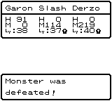
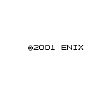
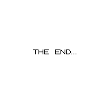

# M8 completion record

M8 is accepted on native Windows x64 on **2026-10-25** for the original main
story through Darck, MagicPlug, the complete credits, THE END, original ending
Save and fresh Continue. All 256 ROM banks are statically compiled, with no
runtime opcode-interpreter fallback.

Game/build source: `3d573873ae8122cbb10fcd5d0f7ae7a33a7609ba`.
Validation/packaging tools: `8859ef67289ce90712a44b9c17174de4519a59b3`.
Recovery: `restore/recomp-m8`. The immutable M7 restore remains
`3bb1e18170fc928f372f9cc72cc433d85c0666ca`; its fixtures are unchanged.

## Accepted Windows package

[Final successful validation and download](https://github.com/rjtvandenhout/DWM2t/actions/runs/40183484388).
[Verified Actions artifact](https://github.com/rjtvandenhout/DWM2t/actions/runs/40183484388/artifacts/12595496311).

Extract `DWM2t-M8-VERIFIED-3d573873ae81.zip` and run `DWM2t-M8/Play.cmd`.
The player needs no Python, CMake, Visual Studio or external ROM file.
[Controls, profiles, ending-save import and reproduction](../handoff/M8_NEXT.md).

| Identity | Bytes | SHA256 |
| --- | ---: | --- |
| Verified player ZIP | 134,795,975 | `2e002da616fa5692ba56ba5b91a1d6ace0049fb596fe6b25d56c65fae200e02e` |
| Production EXE | 725,012,480 | `08757e37154172ca63c13fd90f20d5ab90cddd64a396b716e4632b77c355d063` |
| Diagnostic EXE | 725,575,680 | `f93b7f96212559f65f05e09f8443a224bbda7d124047047fbf53510e16ae0321` |
| Original ending Journal | 32,768 | `0649c4ef78867d2e55f352ddb0fea811fea6e3cf7407f8451220cc2bf01df95d` |

The final player is byte-for-byte identical to the independently built and
tested production EXE. Packaging adds checked validation records around it.
The ZIP contains 26 files, including 18 evidence files; no user/test Saves are
bundled. The tested package manifest SHA256 is
`ef8f5f12c0a02a2440e9bb45b117af07c4a087e9a4573eeb5e6862dd5775987a`.

## Original campaign and stronger monsters

Original controller input completes Oasis, Kids Class, Sea, Ice, Sky and Limbo.
Darck's 4,000-HP encounter is won on the fourth attempt. Garon survives with
91 HP; Slash and Derzo faint. Warubou subsequently heals the party through the
original story. The MagicPlug is recovered and fitted, GreatLog celebrates,
the credits run through their final copyright page without skip input, and
the original THE END follows. The ending Save returns to the title; original
Continue and a subsequent original Journal work.

Squiz was reserved until his required Sea World role was finished. Original
shrine breeding then produced Liset (Octokid +1), Derzo (RayGigas +1) and
Garon (RayGigas +3). Original training develops inherited healing, revival
and combat skills. Parent consumption, roster compaction, genes, learned
skills and Save/Continue persistence are checked.

The ending Journal restores flag `0x25`, all 107 quest bytes and all 17 owned
monsters. Garon/Slash/Derzo are level 40/37/40, fully healed at HP 220/180/207,
status 0/0/0, world 6, region 0/0, position 96/96, with 11G. No RAM dump is a seed;
progression uses genuine original 32-KiB Journals.

[Full progress and screenshots](../handoff/M8_PROGRESS_2026-10-25.md).
[Original frame/hash provenance](../handoff/evidence/2026-10-24/screenshots/provenance.json).

## Actual validation

| Gate | Accepted evidence |
| --- | --- |
| Independent fresh diagnostic and production builds | Same committed source and byte-identical source archives; all 255 ROMX dispatch cases plus fixed bank 0 |
| Retained original native suite | **18 executed and passed, zero failures/skips**, including M1–M7, original battle damage, audio playback/streaming, Journal and Continue |
| Later original campaign | **38 Windows stages**, 4,446,466 recorded frames, four workers, **36m02s** |
| Independent Journal-chain audit | All 38 actual fresh-parent links and all 115 archived 32-KiB Journals verified |
| Original persistence at every stage | Exact Journal hashes, fresh Continue, all 107 quest bytes, complete roster, skills, genes, keys and inventory |
| Copied production package | 21 checks; breeding (12 owned) and ending (17 owned) original GUI Journal/reload, each with two normal shutdowns |
| Final verified package | **21 checks through actual Play.cmd**, followed by ending GUI Journal/reload with 17 owned, all 107 quest bytes and two normal shutdowns |
| Filesystem persistence | Two Windows CTests: 22 base + 19 fault checks; two POSIX CTests: 21 base + 15 fault checks |
| Host/tool contracts | 85 actual Windows contracts in the build run; 20 continuation contracts also pass on Windows |

Raw accepted native audio output records 16,458 original PCM values submitted
and played, followed by 98,753 stream frames submitted and played in each mode.
The original buffered stream has **zero queue-empty events** under its injected
20-ms jitter. The host uses a genuine, Valid-signed Microsoft-published
VB-CABLE Pack45 render endpoint. Physical speaker audibility is unmeasured.

Build/story run
[40175408153](https://github.com/rjtvandenhout/DWM2t/actions/runs/40175408153)
has four successful evidence producers. Its initial suite contains 16 passes
and two unavailable-device skips; its strict final gate correctly rejects it.
The first audio-enabled continuation also correctly rejects a legacy virtual
driver's stream failure. These raw failures remain preserved and unaccepted.
The current signed driver passes five focused original stream tests, then
the complete original 18-test suite in accepted run
[40183484388](https://github.com/rjtvandenhout/DWM2t/actions/runs/40183484388).
No game code, fixture, golden value or test assertion changed to obtain that pass.

That complete suite is configured from the actual original build archive and
uses the unchanged archived diagnostic EXE. The package records build/story
run 40175408153 separately from accepted native/validation run 40183484388 and
the validation-tool commit. Both build archives are 27,443,200 bytes, SHA256
`c75ba57b296c1b2038cd5cc3789059eb4513f79831d64cfb6f4b855a22d72722`.
Their 647-file inventories agree; independent Git archive reproduction also
matches. Original ROM SHA256 remains
`8e38a7420ef5239c7196aa4fd4b1499e65db2823e875bbf8241bb2199e766d4e`.

[Final acceptance audit](../handoff/evidence/2026-10-25-final/final-acceptance-audit.json),
[actual native suite](../handoff/evidence/2026-10-25-final/native-tests-windows.xml),
[actual Play.cmd checks](../handoff/evidence/2026-10-25-final/final-package-windows.json),
[final ending reload](../handoff/evidence/2026-10-25-final/final-ending-journal-windows.json),
and [artifact/checksum index](../handoff/evidence/2026-10-25-final/artifacts.json).
Original raw records retain their line endings and hashes.

Scope is the original main campaign and retained validation paths. Optional
postgame branches are not exhaustively tested. No public release or PR merge
is automated; the verified Windows package is a gated Actions artifact.
